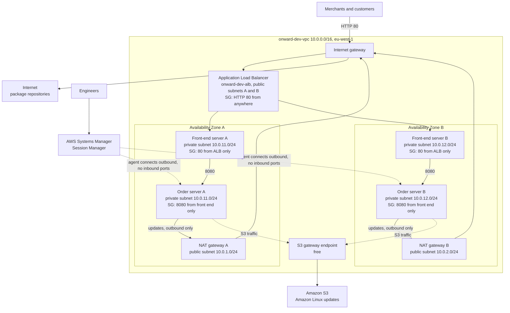

# Onward Logistics: Secure Network for the Order System

Onward Logistics is moving its order system off a single hand-built server into a proper network. This repository builds that network **entirely from code**: a CloudFormation template deployed by **Git sync**, so every change has an author and a time, and the whole setup can be rebuilt from the repository.

The order system has two parts: a **web front end** that merchants and customers use, and **internal order services** that process orders behind the scenes.

- **Discovery report:** [discoveryReport.md](discoveryReport.md) (committed before any infrastructure)
- **Template:** [template.yaml](template.yaml)
- **Git sync deployment file:** [deployment.yaml](deployment.yaml)

## Architecture

**How to read it:** customers only ever reach the **load balancer**. It sends them to front-end servers in **both** Availability Zones, which sit in **private** subnets. The front end calls the internal order servers on port 8080; nothing else can reach them. Private servers download updates **outbound only** through the NAT gateway in their own AZ (and S3 traffic through the free gateway endpoint). Engineers reach any server with **Session Manager**: the server's agent connects **outward**, so no inbound admin port exists. Front-end servers also reach NAT and Systems Manager the same way (not drawn, to keep the diagram readable).

## How each requirement is met

| Leader / requirement | How it is met |
|---|---|
| **CTO:** front end reachable even if part of the data centre fails | A load balancer across two AZs sends traffic only to healthy servers. An **Auto Scaling group** keeps two front-end servers (one per AZ) and replaces any that fail. |
| **Head of Security:** nothing internal reachable from the internet | All servers are in **private subnets** with **no public IP**. Front-end servers accept port 80 **only from the load balancer's security group**; order servers accept port 8080 **only from the front end's security group**. |
| **Head of Security:** no admin ports, no shared keys | **No security group allows port 22**, and **no key pair** is used. Engineers use **Session Manager**; access is controlled by IAM and logged in CloudTrail. |
| **Head of Operations:** engineers can log in to fix servers | Every server wears the role `onward-dev-server-role` (AWS managed policy `AmazonSSMManagedInstanceCore`), so Session Manager works on each one. |
| **Head of Operations:** servers download updates | Private route tables send `0.0.0.0/0` to the **NAT gateway in the same AZ**: outbound only. A free S3 gateway endpoint carries Amazon Linux update traffic. |
| **Finance Lead:** what it costs and why | See the cost section below and the [discovery report](discoveryReport.md). |
| Each front-end server shows my name and the lab name | Installed at boot by the launch template's user data (Apache web server). |
| Free Tier eligible Amazon Linux servers | `t3.micro`, latest Amazon Linux 2023 image looked up from AWS's public Parameter Store. |
| Everything in CloudFormation via Git sync | One template, deployed on every push to `main`. |
| No inline policies | The only IAM permission is attached by ARN (`ManagedPolicyArns`). Security group rules are not IAM policies. |

## Design decisions and rejected alternatives

- **Load balancer + Auto Scaling** over two standalone servers: the load balancer gives one address and routes around failures; Auto Scaling also **replaces** failed servers automatically.
- **Front-end servers in private subnets**, not public: only the load balancer is public, so the servers themselves cannot be attacked directly, and no public IPv4 charges apply to them.
- **Two NAT gateways (one per AZ)** over one: a single NAT gateway would cut updates for both AZs if its AZ failed. Rejected for resilience.
- **Session Manager via the NAT gateways** over interface endpoints: the NAT gateways already provide the outbound path; three interface endpoints in two AZs would add about $44 a month. Rejected on cost.
- **Session Manager** over a bastion host with SSH: a bastion needs port 22 and shared keys, which the Head of Security ruled out.
- **S3 gateway endpoint** added: it is free and keeps update traffic off NAT data charges.

## Estimated monthly cost (eu-west-1, about 730 hours)

| Item | Estimate |
|---|---|
| Application Load Balancer (hours + low traffic) | about $18 to $25 |
| Load balancer public IPv4 (2 AZs) | about $7 |
| NAT gateways (2) | about $70 + data |
| NAT gateway public IPv4 (2) | about $7 |
| EC2 (4 × t3.micro) | $0 to about $33, depending on Free Tier |
| S3 gateway endpoint, Session Manager | $0 |
| **Total** | **about $100 to $140 a month** |

**To reduce it:** one NAT gateway in dev and test only (about $35 less), switch off non-production environments outside working hours.

## Company standards applied

- **Naming:** `onward-<environment>-<purpose>`, for example `onward-dev-alb` and `onward-dev-order-service-a`. The environment is a template parameter.
- **Tags:** `Project = onward`, `Owner`, `Environment` on every taggable resource, set as **stack tags** in `deployment.yaml` (and in the launch templates for servers and disks).
- **Access:** least privilege; no shared accounts; no long-lived keys on servers.
- **Region:** `eu-west-1` (Ireland), an approved Region for the programme.

## Deploy or rebuild

**One-time bootstrap** (the deployment pipeline itself):
1. A CloudFormation service role `onward-dev-cfn-deploy-role`, trusted only by `cloudformation.amazonaws.com`, with `AmazonEC2FullAccess`, `IAMFullAccess` and `AmazonSSMReadOnlyAccess`.
2. A GitHub connection (`onward-dev-github`) and a Git sync role (`onward-dev-gitsync-role`), created in the CloudFormation console.

**Then:** CloudFormation → **Create stack** → **Sync from Git** → stack `onward-dev-order-network`, this repository, branch `main`, deployment file `deployment.yaml`, service role `onward-dev-cfn-deploy-role`. Every later push to `main` is deployed automatically.

## Demonstrating the client's checks

| Check | How to demonstrate |
|---|---|
| Front end reachable from the internet | Open the stack output `WebsiteUrl`; refresh to see servers in both AZs answer |
| Front end survives losing a component | Terminate one front-end server; the site keeps loading from the other AZ, and Auto Scaling launches a replacement |
| Nobody on the internet can reach an internal server | Order servers have no public IP; a connection attempt from outside the VPC times out |
| Internal servers can download a package | In a Session Manager session: `sudo dnf install -y tree` |
| Engineers administer each internal server without open ports | EC2 → instance → **Connect** → **Session Manager** |
| Rebuild from the repository | Delete the stack and recreate it from this repository with Git sync |

## Limits

- One region only: the design survives the loss of an AZ, not a whole region.
- HTTP only; production would add an HTTPS certificate on the load balancer.
- Two front-end servers; real sales-day traffic would need scaling rules.
- The order servers run a placeholder service on port 8080, standing in for the real order software.
